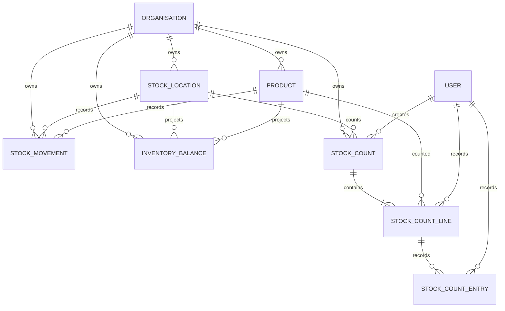

# StockPilot Architecture and Progress

## Verified Vertical Slice

The implemented count workflow creates a draft count for a location and selected products, captures the balance and valuation snapshot, accepts one count quantity per product, and submits only when every line has a value. Submission calculates a variance against the expected quantity at the recorded count time. Submitted count lines are immutable through the API. The variance register is read-only and tenant/branch scoped.

Routes currently implemented for this slice:

- `POST /api/v1/stock-counts/` creates an idempotent count. Requires `Idempotency-Key`.
- `GET /api/v1/stock-counts/` and `GET /api/v1/stock-counts/{id}/` list and retrieve tenant-scoped counts.
- `POST /api/v1/stock-counts/{id}/record/` records a product count quantity. Requires `Idempotency-Key`; a retry returns the original count timestamp.
- `POST /api/v1/stock-counts/{id}/submit/` reconciles and submits a draft.
- `GET /api/v1/variances/` lists submitted non-zero variances.

## Data Relationships



`StockCountLine` stores the expected quantity at the snapshot, latest accepted count-time quantity and timestamp, captured standard cost and retail price, and calculated variance fields. Immutable `StockCountEntry` rows preserve every accepted entry and idempotency key. The full schema in `backend/apps/inventory/models.py` also includes the existing ledger and balance projection.

## Consistency and Security Decisions

- **Source of truth:** `StockMovement` is the append-only source of truth. `InventoryBalance` is a cached projection maintained only by `post_movement()` and reconciled by `find_balance_mismatches()`.
- **Snapshot transaction:** count creation obtains/creates each balance row in stable product order and locks those rows in one transaction. The snapshot timestamp is taken after locks are held. Ledger posting locks the same rows, so a concurrent posting is ordered before or after the snapshot.
- **Count-entry retries:** every accepted entry is an immutable `StockCountEntry` row with an organisation-unique idempotency key. The latest entry updates the count-line projection. Replaying any prior key and payload preserves the latest accepted quantity and timestamp; reusing a key with another payload conflicts. New keys can record an intentional recount while the parent count remains draft.
- **Movement cutoff:** for each line, expected-at-count equals the captured starting balance plus ledger deltas whose database `created_at` is later than `snapshot_at` and no later than that line's `counted_at`. Client-supplied business `occurred_at` does not rewrite the reconciliation timeline.
- **Variance:** `counted_quantity - expected_quantity`. A negative value is a shortage; positive is a surplus. Percentage is signed and uses absolute expected quantity as denominator. If expected is zero and variance is non-zero, percentage is undefined (`null`). Gross shortage, gross surplus, and signed net cost are stored separately.
- **Valuation:** this slice snapshots product `standard_cost` and `selling_price`; it does not implement FIFO or weighted-average cost layers. `shortage_cost` and `surplus_cost` never offset each other.
- **Tenant access:** generic viewsets filter by `request.org`; related-object fields use `OrgPKField`; branch-limited memberships are scoped via `scope_locations()`. Count and variance access has separate permission codes.
- **History:** count/line/entry foreign keys use `PROTECT`; accepted count entries are immutable and submitted count changes are rejected by service state checks. Stock adjustments/approval workflow is not implemented yet.
- **Corrections:** posted stock movement corrections use compensating reversal entries through the existing ledger service, not updates.
- **Database concurrency:** SQLite tests validate domain behavior but not PostgreSQL row-lock guarantees. PostgreSQL is the required environment for concurrency acceptance tests.

## Continuation Checklist

- [x] Tenant-scoped stock count creation and location/product snapshot.
- [x] Blind-count concealment while the count is draft.
- [x] Per-product count recording, required-line validation, and submission.
- [x] Count-time movement reconciliation, variance math, captured cost and retail exposure.
- [x] Immutable, replay-safe count-entry history with delayed-retry protection.
- [x] Tenant-scoped variance API and functional Angular count/variance screens.
- [ ] PostgreSQL concurrency tests for snapshot-versus-movement and duplicate count requests.
- [ ] Recount, count assignment, schedule/cycle/ABC counts, count cutoff policies for transfers, and offline sync.
- [ ] Variance cases, assignments, evidence, investigation timeline, root-cause taxonomy, and SLA/escalation.
- [ ] Approval policies, separation of duties, adjustment requests, atomic approved posting, and reversals.
- [ ] Real dashboard metrics and analytics, filters, chart drill-down, notifications, CSV/Excel/PDF reports.
- [ ] Transfers/in-transit stock, suppliers, purchase orders, receipts, sales, returns, and integrations.
- [ ] Invitations, password recovery, MFA, configurable RBAC administration, and session/security events.
- [ ] Product batches/serials, expiry, costing methods, imports, attachment storage, and reconciliation tools.
- [ ] Complete PostgreSQL migration/test run, frontend unit/e2e tests, operational monitoring, backups, and deployment hardening.

## Local Verification

Backend checks:

```powershell
$env:USE_SQLITE = "1"
Set-Location stockpilot\backend
.\.venv\Scripts\python.exe manage.py check
.\.venv\Scripts\python.exe manage.py makemigrations --check --dry-run
.\.venv\Scripts\python.exe manage.py test tests -v 2
```

Frontend production build:

```powershell
Set-Location stockpilot\frontend
npm run build
```

The SQLite development/demo configuration and fixed demo credentials are not production credentials. Do not deploy with `config.settings.dev`.